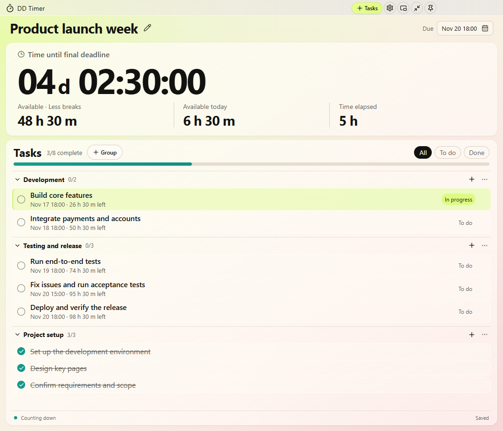
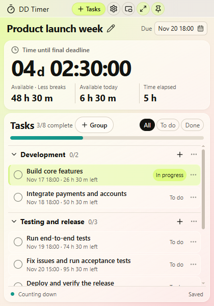

# DD Timer

[](README.zh-CN.md)

DD Timer is a local desktop planning timer for Windows x64. Set a final deadline, split the plan into tasks, and track the countdown, remaining working time, and time elapsed today.

## Screenshots

The demo shows a sample product launch with eight tasks across three groups and a fixed clock.



| Compact window | Floating countdown |
| --- | --- |
|  |  |

## Getting started

Use Windows x64 with Node.js 22.13 or newer. The lockfile pins the dependencies, and the install step prepares the native SQLite module for Electron.

```powershell
npm.cmd ci
npm.cmd run dev
```

The first launch opens the plan creation screen. To try the app with eight sample tasks and a fixed clock, run `npm.cmd run demo`. Demo mode uses a separate `TS Timer-demo` profile.

## Using DD Timer

- Choose **Settings → Language → English** or **简体中文**. On the first launch, open **Settings and archive** to reach the language selector. The interface updates immediately across the main window, floating countdown, and tray. DD Timer remembers the language on this device after a restart or JSON backup import. Existing plan, task, group, and break names appear as saved.
- Create a plan with a name and a final deadline. The app uses the time zone in effect when the plan is created. **Time elapsed** starts at 09:00 each day and stops at the plan deadline. Break rules repeat daily and can cross midnight. Saving new rules recalculates working time.
- Add tasks with optional deadlines. Selecting a date sets the time to 00:00, and you can edit it. Open tasks show how much time is left or whether they are overdue. Use the circle to complete or reopen a task, and click its status to switch between **To do** and **In progress**. You have 10 seconds to undo a task deletion or a plan archive.
- Turn on **Show task groups** in Settings to organize tasks. Use **Group** to create a group, the plus button by its name to add a task, or the task editor to move an existing task. Hiding groups preserves membership. Deleting a group moves its tasks to **Ungrouped**.
- The title bar has controls for the always-on-top compact window, pinning, and the floating countdown. Drag the floating countdown by its heading and right-click it to close it. When the compact window or floating countdown is active, closing the main window hides it. Use the Windows tray icon to restore the window or quit.

## Backups and recovery

DD Timer stores its SQLite database at `%APPDATA%\TS Timer\data\ts-timer.sqlite`. The adjacent `backups` folder keeps the seven most recent daily snapshots and backups made before a migration or import. The app log is `%APPDATA%\TS Timer\data\app.log`.

- Use **Settings → Export backup** to save a JSON backup. Import validates the file, asks for confirmation, and saves a SQLite recovery copy before replacing the current data. The JSON backup includes plans, tasks, groups, break rules, and window settings.
- To restore a SQLite snapshot, fully exit DD Timer. Move the current database and any matching `-wal` and `-shm` files to a safe location, then copy the snapshot into the data folder as `ts-timer.sqlite` and reopen the app.

## Build and test

```powershell
npm.cmd run build
npm.cmd test
npm.cmd run test:desktop
npm.cmd run package:win
```

The desktop suite uses an isolated profile and writes reports and screenshots to `test-results/`. Set `DD_TIMER_TEST_EXE` to the full path of a packaged executable to test that build.

Packaging creates the unsigned per-user installer at `dist/DD-Timer-1.2.0-x64-Setup.exe` and the unpacked app at `dist/win-unpacked/DD Timer.exe`. Keep the entire `win-unpacked` folder if you run that copy. The installer retains app data.

Run the installer test in a Windows user account without an existing DD Timer or TS Timer installation. It covers installation, reinstalling the same version, uninstalling, and installing again with an isolated data profile.

```powershell
$env:DD_TIMER_TEST_INSTALLER = (Resolve-Path '.\dist\DD-Timer-1.2.0-x64-Setup.exe').Path
npm.cmd run test:desktop
Remove-Item Env:DD_TIMER_TEST_INSTALLER
```
