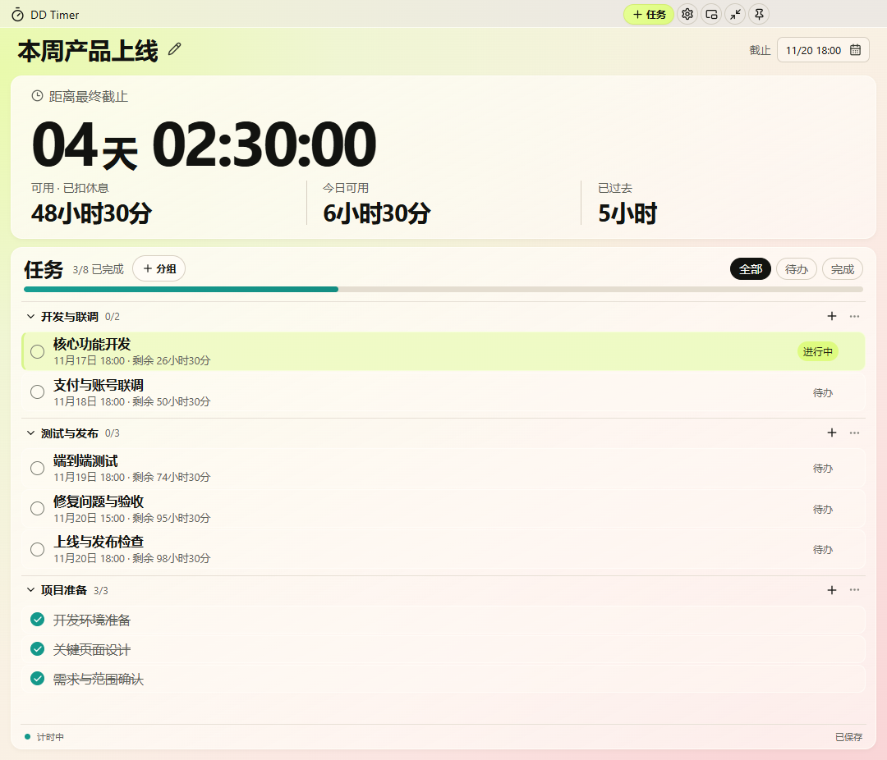

# DD Timer

[](README.md)

DD Timer 是 Windows x64 本地桌面计划计时器。创建计划时记录起点，随后按最终截止显示自然倒计时、剩余可用时间、今日可用和已过去的有效时间。可以拆分任务、查看各任务截止前的剩余时间、设置每日休息、归档计划和备份数据。

## 界面截图

截图使用演示模式中的产品上线计划，包含 3 个分组、8 条样例任务，时钟固定。



| 桌面小窗 | 迷你悬浮窗 |
| --- | --- |
|  |  |

## 启动与打包

在 Windows x64 上使用 Node.js 22.13 或更高版本。开发验证使用 Node.js 25.2.1、npm 11.6.2、Electron 41.10.7、React 19.2.4、TypeScript 5.9.3、electron-vite 5.0.0、better-sqlite3 12.8.0、Temporal polyfill 0.5.1 和 electron-builder 26.8.1。依赖锁定在 `package-lock.json`，构建脚本按 Electron 版本准备 SQLite 原生模块。

```powershell
npm.cmd ci
npm.cmd run dev
npm.cmd run demo
npm.cmd run package:win
```

- `npm run dev` 启动开发窗口。`npm run demo` 用独立的 `TS Timer-demo` 数据目录装载 8 条固定样例，界面时钟固定在 2026 年 11 月 16 日 15:30。正式版首次启动会进入创建计划。
- `npm run package:win` 输出 `dist/DD-Timer-1.2.0-x64-Setup.exe` 和 `dist/win-unpacked/DD Timer.exe`。打包时将 DD Timer 图标写入 Windows 应用程序。直接运行解包版时，请保留 `win-unpacked` 目录中的全部文件。
- 当前安装包按用户安装并保留应用数据，版本为 1.2.0，SQLite 迁移版本为 2。此构建未签名。

## 使用和数据恢复

- 在「设置 → 语言」中选择 English 或简体中文。还没有计划时，可以从「设置与归档历史」进入设置。语言即时切换并在本机保存，重启或导入 JSON 备份后仍会使用当前语言。已有计划、任务、分组及休息时段的名称按原文显示。
- 用名称和最终截止创建计划。应用采用创建时的 IANA 时区。「已过去」每天从 09:00 起算，最多计至计划截止。休息时段每天重复，跨午夜的结束时间按次日计算。保存规则后，剩余可用和已过去都按新规则重新计算。
- 主窗口初始为 1080 × 704。点击标题栏的「桌面小窗」切换为 420 × 598 的置顶小窗，也可以在设置中切换。两个窗口模式各自记住位置和尺寸。
- 标题栏的画中画按钮打开「迷你悬浮窗」，默认置顶在当前屏幕右上角，只显示实时截止倒计时。拖动标题可以移动，右键倒计时或点击标题栏同一按钮可以关闭。迷你悬浮窗打开时，关闭主窗口会将主窗口收进托盘。
- 小窗和最大化窗口使用同一套时间区。倒计时在上方，可用、今日可用和已过去在下方并排显示。
- 小窗的系统关闭按钮会隐藏窗口。点击 Windows 系统托盘里的 DD Timer 图标恢复窗口，右键可退出。用标题栏的图钉随时切换置顶。
- 任务行左侧圆形按钮用于完成和恢复。点击状态在待办与进行中之间切换。点击名称编辑，行尾菜单可删除。删除和归档都可在 10 秒内撤销。
- 任务首次选择截止日期时，时间默认为 00:00，可以手动修改。任务行显示从当前时刻到该任务截止的自然剩余时长，到期后标为逾期。未设置日期的任务显示「未设截止」。
- 在「设置 → 显示任务分组」开启分组。使用任务栏里的「＋ 分组」创建分组，使用组标题旁的「＋」直接添加组内任务。编辑任务时可调整所属分组。组标题可展开和折叠，菜单里可以重命名或删除分组。
- 关闭分组显示时，任务平铺显示，所属分组会保存。删除分组会把组内任务移到「未分组」。分组、任务归属和显示设置随 JSON 备份导出，旧版备份中的任务会作为未分组任务导入。
- 为接续改名前的计划，继续使用 `%APPDATA%\TS Timer\data\ts-timer.sqlite`。同目录的 `backups` 保存最近 7 份每日 SQLite 快照、迁移前备份和导入前备份。数据库日志位于 `data\app.log`。
- 在设置中导出 JSON。导入会先校验文件并请求确认，再备份当前 SQLite 数据库，最后整库替换。建议在升级前导出 JSON。安装器覆盖旧程序时会继续使用原数据目录。
- 如果 SQLite 打开或迁移失败，检查日志、目录写权限和剩余磁盘空间。用 JSON 恢复时，通过设置导入。使用 SQLite 快照恢复时，先彻底退出应用，将当前数据库及同名 `-wal`、`-shm` 文件一并移到其他目录留存，再复制一份快照为 `ts-timer.sqlite`。运行中使用 SQLite 备份接口生成一致性文件。

## 验证

```powershell
npm.cmd run typecheck
npm.cmd test
npm.cmd run build
npm.cmd run test:desktop
```

桌面流程使用隔离数据目录，包含截图样例和 500 项任务测试。截图与测试报告写到 `test-results`。验证打包后的可执行程序，可在运行桌面测试前设置 `DD_TIMER_TEST_EXE` 为可执行文件的完整路径。

安装器验收应在尚未安装 DD Timer 或旧版 TS Timer 的 Windows 用户环境运行。它会执行安装、同版本覆盖、卸载和重装，并使用临时应用数据目录。

```powershell
$env:DD_TIMER_TEST_INSTALLER = (Resolve-Path '.\dist\DD-Timer-1.2.0-x64-Setup.exe').Path
npm.cmd run test:desktop
Remove-Item Env:DD_TIMER_TEST_INSTALLER
```

### 1.2.0 验收记录

验证了分组创建、重命名、折叠、组内新增任务、移动现有任务、按状态筛选、关闭显示后保留归属、重启记住显示设置、删除分组后保留任务，以及带分组备份的恢复。SQLite v1 数据升级会保留原有任务，并生成升级前备份。新版也能导入 JSON v1 备份。

### 1.1.1 验收记录

验证了任务首次选择日期时预填 00:00、自定义时间保存、剩余时间自动更新和到期提示。Windows 从程序文件提取的图标与 DD Timer 图标一致，安装包内的程序、应用资源和图标与解包验证的文件一致。

### 1.1.0 验收记录

测试环境为 Windows 10 专业版 x64（19045），Intel Core i5-9400，32 GB 内存。

- 27 项单元测试覆盖固定样例、休息并集和半开区间、跨午夜、夏令时、日历跳日、时钟回拨、舍入和工作量统计。
- 桌面测试覆盖首次启动、创建计划与 8 项任务、完成与恢复、重启、休息规则、窗口置顶、任务晚于目标提示、保存失败重试、归档和备份。测试以隔离的数据库运行，并在 500 项任务时测试筛选和状态切换。
- 小窗测试检查窗口尺寸、自动置顶、关闭后隐藏及显示，重启后恢复小窗模式和位置。截图测试对比常规、最大化和小窗中的倒计时与三项时间数据。
- 迷你悬浮窗测试检查右上角定位、置顶、实时更新、修改截止后同步、到点归零、主窗口隐藏后继续显示、右键关闭及归档后关闭。
- Windows x64 安装版通过全新安装、同版本覆盖、卸载与重装验收。隔离测试目录中的计划和任务在重装后可用。测试机器上首次启动到创建页约 1.4 秒，500 项任务的 SQLite 快照读取与 IPC 返回合计约 97 毫秒。500 项任务测试后，主进程和渲染进程工作集分别约 122 MiB 与 270 MiB。
- 10 年计划与 20 条每日规则的索引构建在同机 Node.js 测试中耗时约 0.8 秒。
- 休眠恢复使用 Electron 系统恢复事件模拟。缩放用应用视口和 100%、125%、150% 页面缩放验证。备份测试用预设路径驱动文件对话框，执行实际文件读写和数据库事务。发布前可在目标机器补验真实休眠、系统级 DPI 和交互式 Windows 对话框。

Electron 的三进程、打包和 SQLite 一致性备份分别参考 [Electron 安全文档](https://www.electronjs.org/docs/latest/tutorial/security)、[electron-vite 文档](https://electron-vite.org/guide/) 和 [better-sqlite3 API](https://github.com/WiseLibs/better-sqlite3/blob/master/docs/api.md)。
